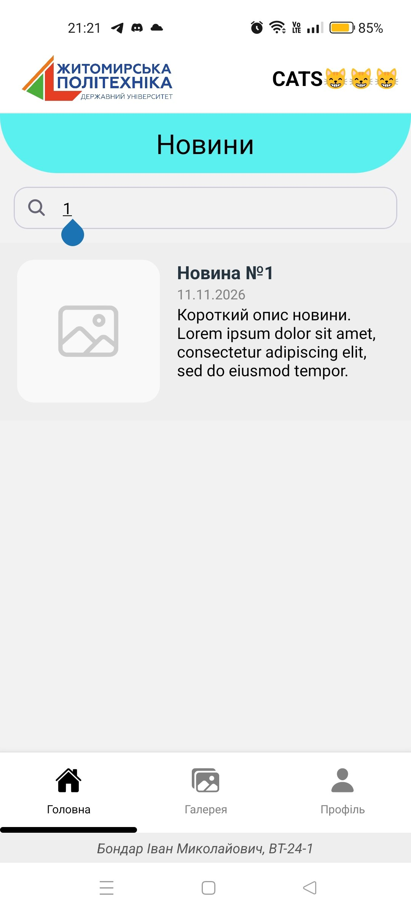
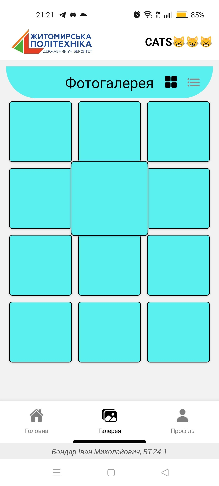
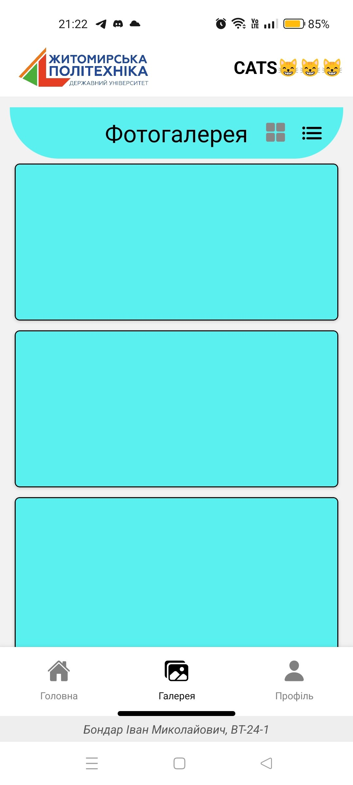
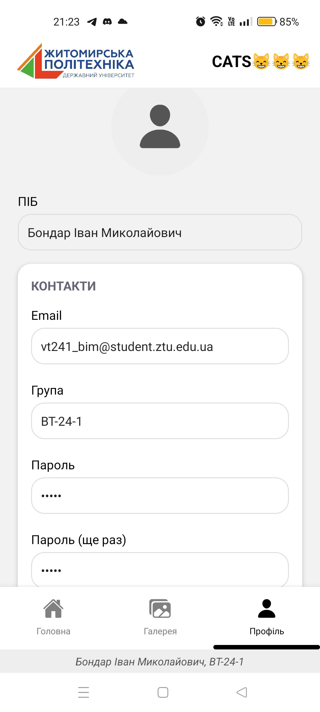
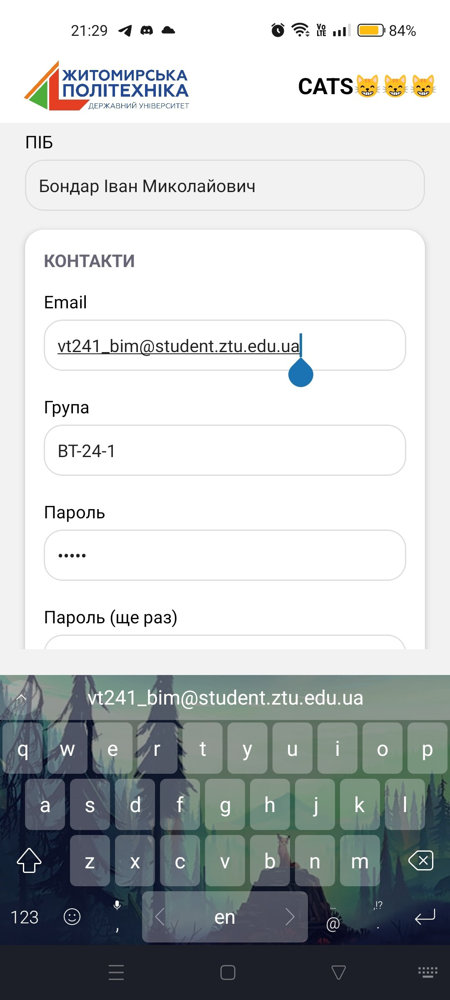

# Лабораторна робота 1
Використання Expo для створення простенького додатку React Native. Знайомство з основними компонентами

---

## 📝 Опис

Застосунок **CATS😸😸😸**є  багатосторінковим мобільним застосуноком, що демонструє базові принципи побудови інтерфейсів у React Native з використанням Expo.

### Основні можливості

*   **Навігація:** `@react-navigation/material-top-tabs` із `tabBarPosition="bottom"`  нижня панель вкладок з іконками (`@expo/vector-icons`), перемикання натисканням або свайпом.
*   **Спільні елементи:** компоненти `TopBar`  та `BottomInfo` що відображаються на всіх екранах.
*   **Екран «Головна» (`HomeScreen`):**
    *   список новин на `FlatList` , а саме зображення-заглушка, заголовок, дата, опис);
    *   поле пошуку, що фільтрує новини за заголовком (`useState` + `useMemo`).
*   **Екран «Галерея» (`PhotoGalleryScreen`):**
    *   сітка з трьох колонок (`numColumns`) з можливістю перемкнути на режим списку
    *   компонент `ZoomTile` з бібліотекою **Animated**: при натисканні плитка плавно збільшується в 1.5 раза (`Animated.spring`), після відпускання повертається до початкового розміру.
*   **Екран «Профіль» (`RegistrationScreen`):**
    *   форма з полями ПІБ, Email, Група, Пароль (двічі) — багаторазовий компонент `LabeledField`;
    *   картки «Контакти» та «Налаштування» з перемикачем `Switch` для сповіщень;
    *   `KeyboardAvoidingView` + `ScrollView` — клавіатура не перекриває поля;
    *   автоматичне приховування клавіатури при натисканні на порожнє місце (`TouchableWithoutFeedback` + `Keyboard.dismiss`).
*   **Стилізація:** була використана вбудована `StyleSheet API` та макетна система Flexbox

---

## 🚀 Інструкція із запуску

1. **Клонуйте репозиторій:**
   ```bash
   git clone https://github.com/VanyaBond/MobileLabsRN2026
   ```

2. **Перейдіть до папки проєкту:**
   ```bash
   cd MobileLabsRN2026/lab1
   ```

3. **Встановіть залежності:**
   ```bash
   npm install
   npx expo install @react-navigation/native @react-navigation/material-top-tabs react-native-tab-view react-native-pager-view react-native-safe-area-context react-native-screens @expo/vector-icons
   ```

4. **Запустіть проєкт:**
   ```bash
   npx expo start
   ```
   Інші варіанти: `npx expo start --clear` (з очищенням кешу), `npx expo start --android` (одразу в емуляторі), `npx expo start --tunnel` (різні мережі).

5. **Відкрийте застосунок:**
   *   Відскануйте QR-код у додатку **Expo Go** (Android) або камерою (iOS);
   *   або натисніть `a` у терміналі для запуску на емуляторі Android.

---

## 📱 Скріншоти застосунку

| Головна | Галерея (при натисканні) | Галерея Списком | Профіль |
| :---: | :---: | :---:| :---: |
|  |  |  |  |

### Форма з відкритою клавіатурою



---

## 🔍 Способи запуску та тестування

### 1. Фізичний пристрій через Expo Go
**Призначення:** перевірка реальної продуктивності, жестів і роботи клавіатури.
*   **Особливості:** найточніше відображає відгук інтерфейсу, анімації та `SafeAreaView`.
*   **Відмінності:** пристрій і комп'ютер мають бути в одній Wi-Fi мережі,якщо звісно не використовуєм `--tunnel`

### 2. Емулятор Android 
**Призначення:** розробка без фізичного пристрою.
*   **Особливості:** можна перевіряти різні версії Android і розміри екранів.
*   **Відмінності:** швидкий цикл «зміна коду — оновлення», але анімації можуть бути менш плавними через навантаження на ПК, або взагалі не плавними якщо ресурсів не вистачає

### 3. Режим Tunnel (`--tunnel`)
**Призначення:** підключення, коли комп'ютер і телефон у різних мережах.
*   **Особливості:** трафік іде через проксі-сервіс 
*   **Відмінності:** повільніше завантаження бандла та затримки Hot Reload.

### 4. Онлайн-середовище Snack 
**Призначення:** швидка перевірка коду без встановлення ПЗ.
*   **Особливості:** працює в браузері, є попередній перегляд на пристрої через Expo Go.
*   **Відмінності:** обмежена робота з локальними ресурсами, ті ж зображення потрібно завантажувати окремо

---

## 📂 Структура папки lab1

*   `src/assets/` — локальні зображення логотип
*   `assets/` — скріншоти для README;
*   `App.js` — основний файл: навігація, екрани, компоненти та стилі;
*   `package.json` — залежності проєкту

## Висновок

Під час лабораторної роботи  було створено та налаштовано проєкт Expo, вивчено структуру застосунку React Native й роботу з базовими компонентами такими як`View`, `Text`, `Image`, `FlatList`, `TextInput`, `Switch`, `ScrollView`. Реалізовано навігацію вкладками, стилізацію через `StyleSheet` і Flexbox, анімацію збільшення елементів галереї через `Animated`, а також обробку клавіатури у формі. Застосунок протестовано на емуляторі Android і фізичному пристрої через Expo Go; опановано способи запуску, зокрема режим Tunnel