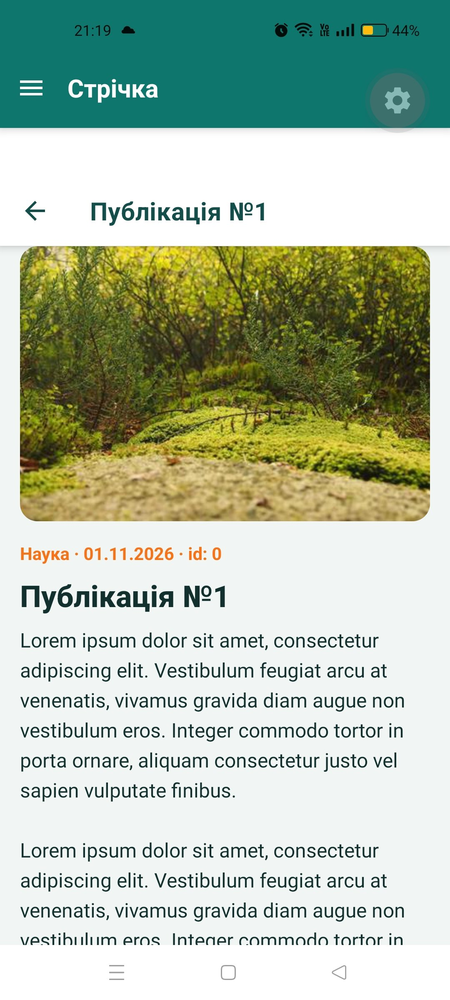

# Лабораторна робота №2: Віртуалізація списків та побудова навігації в Expo Router

## 📝 Опис

Розроблена апка **Lab2 Hub** демонструє ієрархічну навігацію Expo Router (Drawer + вкладений Stack), захищені маршрути на основі контексту авторизації та оптимізовану роботу з великими списками (`FlatList`, `SectionList`).

### Основні можливості

*   **Глобальний стан авторизації:** `SessionProvider` (`src/auth/SessionContext.jsx`) зі станом `isAuthenticated` та функціями `login()` / `logout()`; провайдер обгортає кореневий `app/_layout.jsx`.
*   **Публічний екран входу** (`app/login.jsx`) форма з валідацією і після успішного входу користувача автоматично перенаправляє `<Redirect>`.
*   **Захищена Drawer-навігація** (`app/(drawer)/_layout.jsx`): для неавторизованих — `<Redirect href="/login" />`,а для авторизованих — `<Drawer>` з власним меню (профіль користувача, пункти навігації та кнопка **«Вийти»**, що викликає `logout()`).
*   **Вкладений Stack** (`app/(drawer)/(news)/_layout.jsx`) з `headerShown: false`, щоб заголовок стека не дублював заголовок Drawer.
*   **Стрічка (`FlatList`, 120+ елементів):**
    *   **Pull-to-Refresh** через `RefreshControl`;
    *   **Infinite Scroll** через `onEndReached` та `onEndReachedThreshold`;
    *   **Оптимізація:** `getItemLayout` (фіксована висота рядка), картка `PostCard` обгорнута в `React.memo`, `useCallback` для обробників, параметри `initialNumToRender`, `maxToRenderPerBatch`, `windowSize`, `removeClippedSubviews`.
*   **Динамічний маршрут** `app/(drawer)/(news)/[id].jsx`: параметр `id` читається через `useLocalSearchParams`.
*   **Довідковий центр** `app/(drawer)/faq.jsx`: `SectionList` зі згрупованими запитаннями та відповідями.
*   **Safe areas:** `SafeAreaProvider` та `useSafeAreaInsets` для відступів від вирізів і системних панелей.

---

## 🚀 Інструкція із запуску

1. **Клонуйте репозиторій:**
   ```bash
   git clone https://github.com/VanyaBond/MobileLabsRN2026
   ```

2. **Перейдіть до папки проєкту:**
   ```bash
   cd MobileLabsRN2026/lab2
   ```

3. **Встановіть залежності:**
   ```bash
   npm install
   npx expo install expo-router @react-navigation/drawer react-native-gesture-handler react-native-reanimated react-native-worklets react-native-safe-area-context react-native-screens @expo/vector-icons expo-status-bar
   ```

4. **Запустіть проєкт:**
   ```bash
   npx expo start
   ```
   Інші варіанти: `npx expo start --clear` (очищення кешу), `npx expo start --tunnel` (різні мережі).

5. **Відкрийте застосунок:** відскануйте QR-код у **Expo Go** або натисніть `a` для емулятора Android.

> Для входу підійде будь-яка пошта з `@` та пароль від 4 символів.

---

## 📱 Скріншоти застосунку

| Екран входу | Drawer-меню | Стрічка (FlatList) |
| :---: | :---: | :---: |
|  |  |  |

| Деталі (динамічний маршрут) | Pull-to-Refresh | infinitive loading |
| :---: | :---: |
|  |  |  | 

| Довідковий центр (SectionList) |
| :---: |
|  |

---

## 📂 Структура проєкту (lab2)

```
app/
├── _layout.jsx              — кореневий layout + SessionProvider
├── login.jsx                — публічний екран входу
└── (drawer)/
    ├── _layout.jsx          — захист маршрутів + Drawer
    ├── faq.jsx              — SectionList
    └── (news)/
        ├── _layout.jsx      — вкладений Stack (headerShown: false)
        ├── index.jsx        — FlatList-стрічка
        └── [id].jsx         — деталі публікації
src/
├── auth/SessionContext.jsx  — контекст авторизації
├── data/feed.js             — генерація даних
└── theme.js                 — кольори та відступи
```

---

## 🔍 Контрольні запитання

1. **Як працює вкладена навігація в Expo Router?**
   Навігація визначається файловою структурою папки `app`Кожна папка з `_layout.jsx` то є навігатор як Stack, Tabs, Drawer, а вже файли всередині — його екрани. Папка в дужках `(news)` є групою маршрутів => вона не додає сегмент до URL, але може мати власний layout. Тому в цій роботі Stack `(news)` вкладений у Drawer `(drawer)`.

2. **Як реалізується захист маршрутів?**
   У layout групи `(drawer)` читається `isAuthenticated` із контексту, а якщо він `false`, повертається `<Redirect href="/login" />`, і всі вкладені екрани стають недоступними. Після `login()` екран входу, у свою чергу, перенаправляє в застосунок, а `logout()` знову скидає доступ.

3. **Чим FlatList відрізняється від ScrollView та що таке віртуалізація?**
   `ScrollView` одразу рендерить усі дочірні елементи, що повільно й витратно за пам'яттю на великих списках. `FlatList` застосовує віртуалізацію: монтує лише елементи у видимій області та навколо неї, а решту не рендерить або видаляє з пам'яті , що  зберігає плавність скролу навіть для сотень записів + ресурси нашого смартфона не витрачаються даремно

4. **Як отримати параметри динамічного маршруту?**
   На цільовому екрані (`[id].jsx`) викликається хук `useLocalSearchParams()`, який повертає об'єкт параметрів`const { id } = useLocalSearchParams();`а  перехід виконується через `router.push({ pathname: '/[id]', params: { id } })`.

5. **Яку структуру даних приймає SectionList?**
   Масив секцій `sections`, кожна з яких є об'єктом із полем `data`  та додатковими полями, наприклад `title`. Для відображення задаються `renderItem` та `renderSectionHeader`.

---

## Висновок

У ході роботи створено застосунок на Expo Router з глобальним станом авторизації, публічним екраном входу, захищеною Drawer-навігацією та вкладеним Stack. Для стрічки на 120+ елементів реалізовано Pull-to-Refresh, Infinite Scroll та оптимізації (`getItemLayout`, `React.memo`, налаштування вікна рендерингу). Динамічний маршрут `[id]` отримує параметри через `useLocalSearchParams`, а довідковий центр побудовано на `SectionList`. Опановано файлову маршрутизацію, групи маршрутів та підходи до віртуалізації списків.
