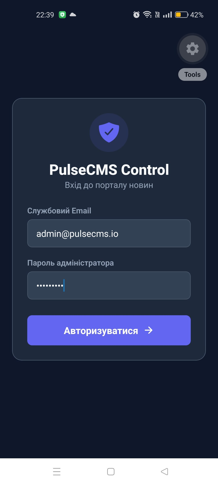
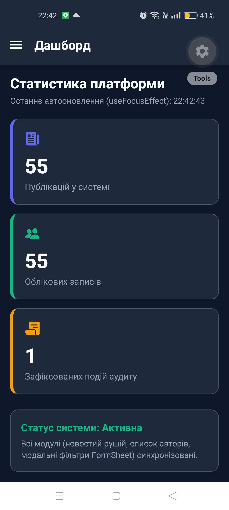
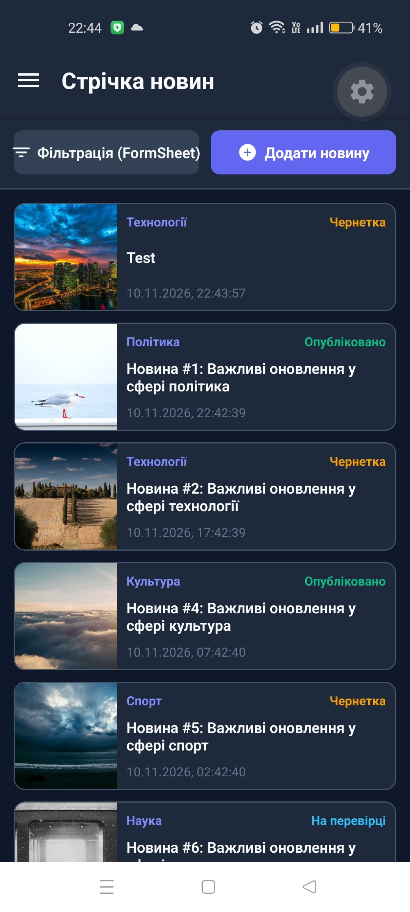
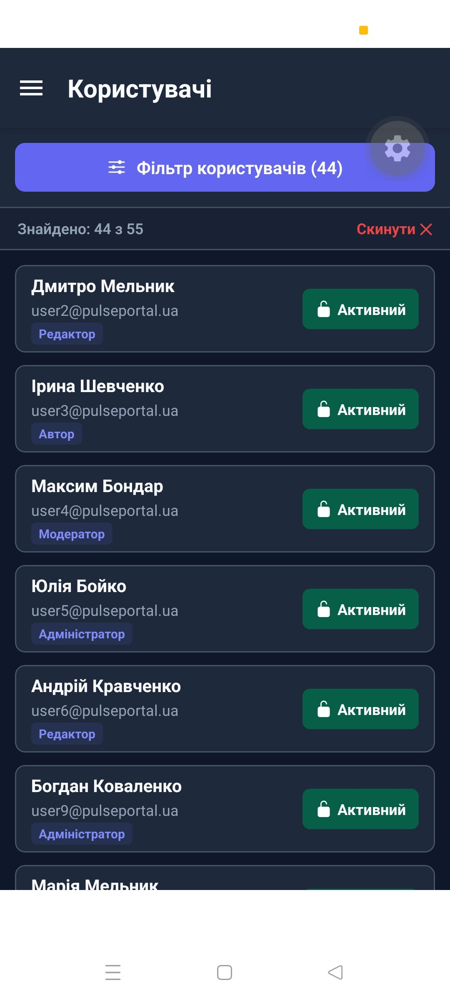
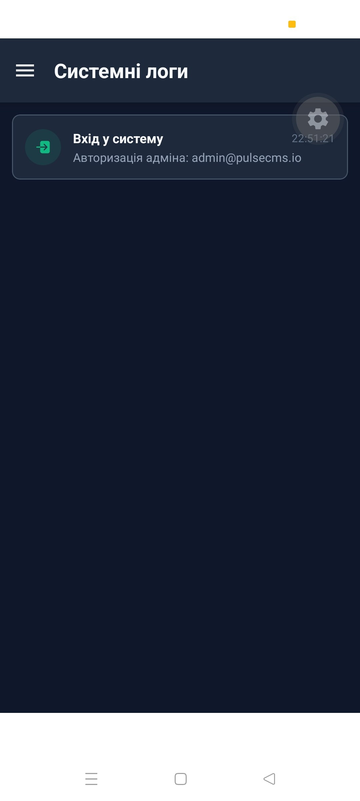
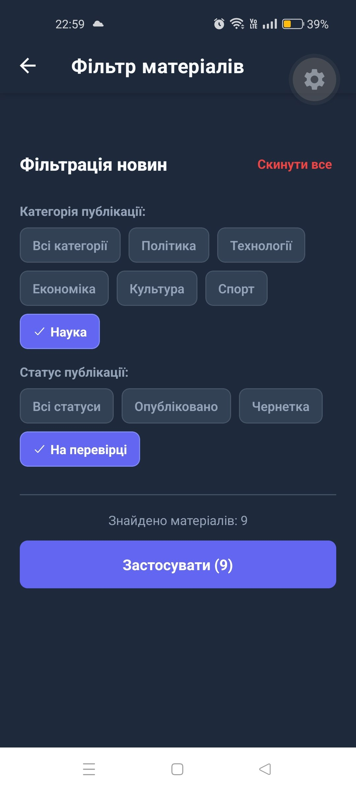
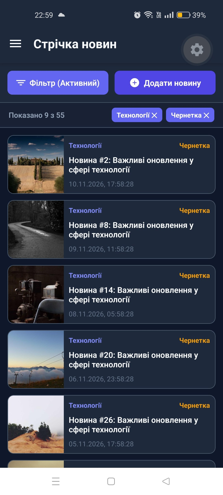

# Лабораторна робота №3: Expo Router: кастомізація навігаційних компонентів, нативні модальні вікна та віртуалізація списків

## 📝 Опис

Апка **PulseCMS Admin Suite** то повноцінний прототип панелі адміністрування сучасного новинного медіапорталу. Застосунок спроєктовано з використанням файлової маршрутизації **Expo Router**, кастомізованого бічного меню (`Custom Drawer`), нативних модальних вікон (`presentation: 'modal'` та `presentation: 'formSheet'`), а також оптимізованого рендерингу великих наборів даних за допомогою компонента `VirtualizedList`.

### Основні можливості

*   **Автентифікація та захист маршрутів:**
    *   Публічний екран авторизації (`app/login.jsx`) з валідацією пошти та пароля;
    *   Захист розділів адміністрування: автоматичний `<Redirect href="/login" />` для неавторизованих користувачів у файлі `app/(admin)/_layout.jsx`.
*   **Кастомізоване бокове меню (`AdminDrawerContent`):**
    *   Профіль адміністратора (фото, повне ім'я, службова пошта, бейдж статусу);
    *   Пункти навігації: **Дашборд**, **Стрічка новин**, **Користувачі**, **Системні логи**;
    *   Нижня кнопка **«Вийти з системи»** із фіксацією системної події.
*   **Дашборд аналітики (`app/(admin)/index.jsx`):**
    *   Відображення лічильників публікацій, користувачів та подій аудиту;
    *   Використання хука `useFocusEffect` для миттєвої актуалізації даних при кожному поверненні на екран.
*   **Оптимізована віртуалізація (`VirtualizedList`):**
    *   Реалізовано в розділах **Новини**, **Користувачі** та **Системні логи**;
    *   Використано параметри `getItemCount`, `getItem`, фіксований розрахунок геометрії `getItemLayout`, `initialNumToRender`, `maxToRenderPerBatch`, `windowSize` та `removeClippedSubviews`.
*   **Динамічна навігація та CRUD новин:**
    *   Динамічний маршрут перегляду публікації `app/news/[id].jsx` із читанням параметра через `useLocalSearchParams`;
    *   Редагування та створення новин у повноцінному нативному вікні `presentation: 'modal'`;
    *   Видалення матеріалу із підтвердженням через нативний діалог `Alert.alert()`.
*   **Управління користувачами та аудитом:**
    *   Список облікових записів з ролями та перемиканням статусу (Активний / Заблокований);
    *   Автоматичний логер 6 ключових подій: *Вхід у систему*, *Вихід із системи*, *Створення новини*, *Редагування новини*, *Видалення новини*, *Зміна статусу користувача*.
*   **Нативні FormSheet фільтри:**
    *   Модальні форми `presentation: 'formSheet'` із параметрами `sheetAllowedDetents` для фільтрації списку новин та користувачів за статусом і категорією.
*   **Безпечні зони:** Врахування системних відступів панелей та вирізів через `useSafeAreaInsets` та `SafeAreaProvider`.

---

## 🚀 Інструкція із запуску

1. **Клонуйте репозиторій:**
   ```bash
   git clone https://github.com/VanyaBond/MobileLabsRN2026
   ```

2. **Перейдіть до директорії лабораторної роботи №3:**
   ```bash
   cd MobileLabsRN2026/lab3
   ```

3. **Встановіть залежності проєкту:**
   ```bash
   npm install
   npx expo install expo-router @react-navigation/drawer react-native-gesture-handler react-native-reanimated react-native-safe-area-context react-native-screens @expo/vector-icons expo-status-bar
   ```

4. **Запустіть сервер розробки:**
   ```bash
   npx expo start
   ```
   *Додаткові параметри за потреби:*
   * `npx expo start --clear` — запуск з очищенням кешу;
   * `npx expo start --tunnel` — тунельоване підключення для різних мереж.

5. **Відкрийте застосунок:** відскануйте QR-код за допомогою застосунку **Expo Go** або натисніть `a` для запуску в Android Emulator.

> **Тестові дані облікового запису:**
> * Email: `admin@pulsecms.io`
> * Пароль: `admin2026` (або будь-який від 4 символів)

---

## 📱 Скріншоти застосунку

| Авторизація | Бокове меню (Custom Drawer) | Дашборд  |
| :---: | :---: | :---: |
|  |  |  |

| Стрічка новин  | Деталі новини ([id].jsx) | Створення/Редагування (modal) | pop-up погодити видалення  |
| :---: | :---: | :---: |
|  |  |  |

| Користувачі (VirtualizedList) | Логи аудиту дій | Фільтрація   | Показ відфільтрованого |
| :---: | :---: | :---: | :---: |
|  |  |  |  |

---

## 📂 Структура проєкту 

```
lab3/
├── app/
│   ├── _layout.jsx                  — кореневий layout, стек модалок та контекст
│   ├── login.jsx                    — публічний екран входу
│   ├── (admin)/
│   │   ├── _layout.jsx              — налаштування Drawer та захист сесії
│   │   ├── index.jsx                — дашборд аналітики (useFocusEffect)
│   │   ├── news.jsx                 — віртуалізована стрічка новин (VirtualizedList)
│   │   ├── users.jsx                — управління користувачами (VirtualizedList)
│   │   └── logs.jsx                 — журнал подій аудиту (VirtualizedList)
│   ├── news/
│   │   └── [id].jsx                 — динамічний маршрут деталей новини
│   └── modals/
│       ├── editor.jsx               — нативне модальне вікно (presentation: 'modal')
│       ├── news-filter.jsx          — фільтр новин (presentation: 'formSheet')
│       └── user-filter.jsx          — фільтр користувачів (presentation: 'formSheet')
├── src/
│   ├── components/
│   │   └── AdminDrawerContent.jsx   — кастомний компонент бокового меню
│   ├── context/
│   │   └── PortalContext.jsx        — єдине джерело стану: auth, 50+ новин/юзерів, логи
│   └── theme/
│       └── palette.js               — кольори інтерфейсу
├── package.json
└── README.md
```

---

## 🔍 Контрольні запитання

1. **Яким чином виконується кастомізація бічного меню та хедера стекової навігації за допомогою drawerContent та screenOptions.header?**
   * **Кастомізація бокового меню (`drawerContent`):** У компоненті навігатора `<Drawer>` передається проп `drawerContent={(props) => <CustomDrawer {...props} />}`, що  дозволяє повністю замінити стандартний контейнер меню власним React-компонентом, у якому можна розташувати шапку кастомну профілю , відрендерити навігаційні посилання за допомогою `<DrawerItemList {...props} />` або власних кнопок, а також розмістити закріплений футер ту ж кнопку «Вийти»
   * **Кастомізація хедера стека (`screenOptions.header`):** Перевизначення властивості `header` (або `headerStyle`, `headerTintColor`, `headerTitle`, `headerRight`) у `screenOptions` або в конкретному `<Stack.Screen options={{...}}>` дозволяє передати власну JSX-функцію `header: ({ options, route, navigation }) => <CustomHeader />`. Це надає повний контроль над виглядом верхньої панелі, а саме висота, фонові градієнти, кастомні іконки дій, пошукові поля замість використання стандартного нативного хедера ОС.

2. **У чому відмінність між нативними режимами модальних вікон presentation: 'modal' та presentation: 'formSheet'?**
   * **`presentation: 'modal'`:** Відкриває екран у класичному повноекранному або напівповноекранному нативному модальному стилі, котрий ідеально підходить для самостійних робочих процесів: великих форм редагування, багатоетапних майстрів створення контенту або екранів налаштувань.
   * **`presentation: 'formSheet'`:** Відкриває модальне вікно у вигляді компактного нижнього аркуша (bottom sheet / card sheet), що перекриває лише частину екрана. При цьому на підтримуваних платформах, як iOS 16+ можна конфігурувати масив висот зупинки через параметр `sheetAllowedDetents`, як `[0.5, 0.85]`, що дозволяє користувачеві гнучко розгортати або згортати шторку жестом свайпу. Цей режим найкраще підходить для контекстних фільтрів, сортувань або швидких дій над поточним списком.

3. **Для чого використовується хук useFocusEffect і чим він відрізняється від стандартного useEffect?**
   * Стандартний `useEffect` спрацьовує лише під час монтування компонента або зміни значень у масиві залежностей. У стековій або табовій/drawer-навігації екрани часто не розмонтовуються, а залишаються в пам'яті у фоновому стані  Тому при повторному переході на екран `useEffect` не спрацює вдруге.
   * `useFocusEffect` (з `expo-router` / `@react-navigation/native`) призначений для коду, який повинен виконуватися **кожного разу, коли екран опиняється у фокусі уваги користувача**, і зупинятися (виклик cleanup-функції), коли користувач переходить на інший екран або згортає його. Це критично важливо для актуалізації аналітики, оновлення бейджів, перезавантаження списку чи синхронізації лічильників дашборду. Для уникнення нескінченних повторних викликів функція-ефект обов'язково обгортається в `useCallback`.

---

## 🏁 Висновок

Під час виконання лабораторної роботи №3 було успішно опановано можливості Expo Router для побудови складних ієрархічних інтерфейсів
1. Створено кастомізоване Drawer-меню з відображенням даних адміністратора та розділом керування сесією
2. Реалізовано захист маршрутів на рівні групи `(admin)` за допомогою автоматичного редиректу
3. Досліджено та застосовано хук `useFocusEffect` для гарантованої актуалізації статистики дашборду при отриманні фокусу
4. Оптимізовано рендеринг великих масивів даних (понад 50 новин, 50 користувачів та системні логи) за допомогою компонента `VirtualizedList` із точним розрахунком `getItemLayout`
5. Інтегровано нативні модальні вікна: форму редагування матеріалу в режимі `presentation: 'modal'` та швидкі контекстні панелі фільтрації в режимі `presentation: 'formSheet'` із параметрами `sheetAllowedDetents`
6. Реалізовано повний цикл логування 6 системних подій платформи та нативні діалоги видалення через `Alert.alert()`
