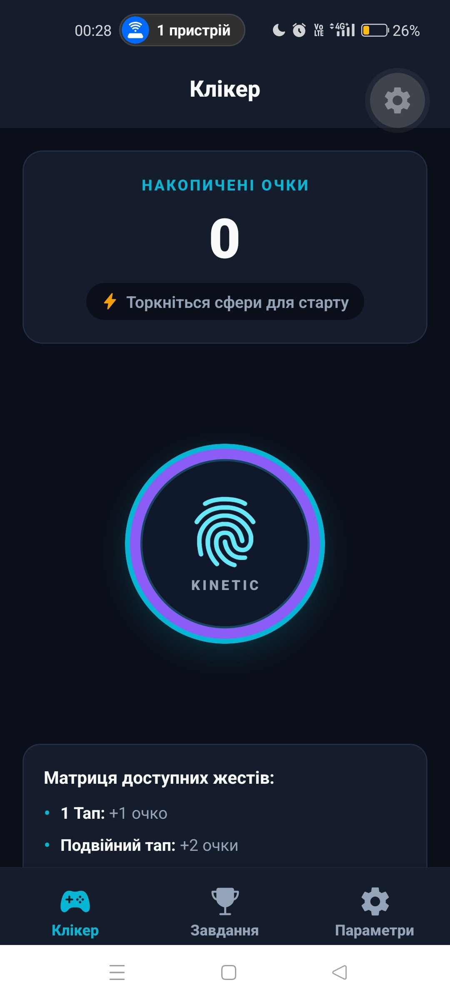
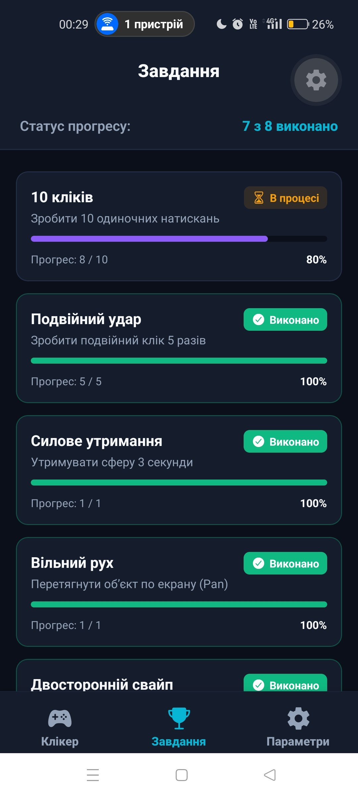
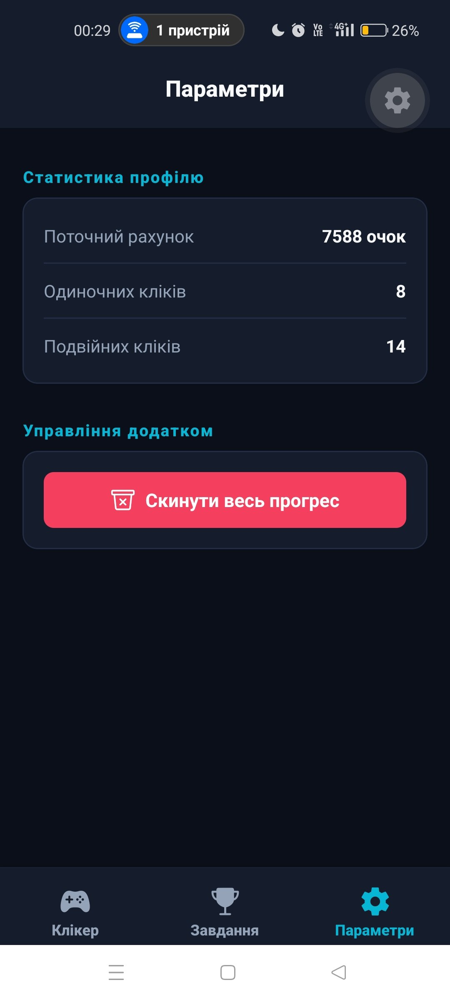

# Лабораторна робота №4: Опрацювання жестів користувача та реалізація інтерактивної взаємодії у React Native

## 📝 Опис

У рамках лабораторної роботи розроблено апку **«KineticOrb Clicker»** на базі **Expo Router** та сучасної бібліотеки жестової взаємодії **React Native Gesture Handler (v2 Gestures API)** разом з **React Native Reanimated**.

Головним інтерактивним елементом застосунку є енергетична Kinetic Orb, яка розпізнає комплексні сценарії жестів, обчислює очки та динамічно актуалізує перелік ігрових завдань.

### Основні можливості

*   **Коренева конфігурація:** `GestureHandlerRootView` та `SafeAreaProvider` у файлі `app/_layout.jsx` для стабільної роботи жестової системи та захисту від вирізів екрана.
*   **Інтерактивна жестова сфера (`InteractiveOrb`):**
    *   **TapGestureHandler (Single Tap):** Одиночне натискання нараховує **+1 очко**.
    *   **TapGestureHandler (Double Tap):** Подвійне натискання нараховує **+2 очки**.
    *   **LongPressGestureHandler:** Утримання об'єкта протягом 3 секунд активує бонусну винагороду (**+15 очок**).
    *   **PanGestureHandler:** Плавне переміщення об'єкта по площині екрана з автоповерненням у вихідну позицію (`withSpring`).
    *   **FlingGestureHandler:** Швидкі свайпи вліво та вправо приносять випадковий діапазон очок (5–25) та анімований зсув.
    *   **PinchGestureHandler:** Масштабування (збільшення/зменшення) двома пальцями з нарахуванням очок.
*   **Пріоритезація та композиція жестів:**
    *   `Gesture.Exclusive(doubleTap, singleTap)`   гарантує, що одиночний клік не спрацьовує хибно під час виконання подвійного.
    *   `Gesture.Simultaneous(pan, pinch, ...)`   дозволяє одночасно перетягувати та масштабувати сферу.
    *   `Gesture.Race(...)`   конкурентний вибір між швидким свайпом, утриманням та кліками.
*   **Сторінка завдань (`app/(tabs)/quests.jsx`):**
    *   Автоматичний трекінг виконання 8 вимог (10 кліків, 5 дабл-кліків, утримання 3с, перетягування Pan, свайпи Fling L/R, Pinch, 100 очок);
    *   Власне комбіноване завдання: *«Синхронний трюк: Pinch під час перетягування Pan»*;
    *   Візуальні прогрес-бари для кожного завдання та статуси («Виконано» / «В процесі»).
*   **Сторінка параметрів (`app/(tabs)/settings.jsx`):**
    *   Відображення статистики жестів;
    *   Скидання прогресу із діалогом підтвердження `Alert.alert()`.

---

## 🚀 Інструкція із запуску

1. **Клонуйте репозиторій:**
   ```bash
   git clone https://github.com/VanyaBond/MobileLabsRN2026
   ```

2. **Перейдіть до директорії проєкту:**
   ```bash
   cd MobileLabsRN2026/lab4
   ```

3. **Встановіть залежності проєкту:**
   ```bash
   npm install --legacy-peer-deps
   ```

4. **Запустіть сервер розробки:**
   ```bash
   npx expo start --clear
   ```

5. **Запустіть додаток:** Відскануйте QR-код через застосунок **Expo Go** на телефоні або натисніть `a` для емулятора Android.

---

## 📱 Скріншоти застосунку

| Головний екран (Клікер) | Жестова взаємодія (Pan / Pinch) |
| :---: | :---: |
|  |  |

| Список завдань (Квести) | Налаштування та скидання |
| :---: | :---: |
|  |  |

---

## 📂 Структура проєкту (lab4)

```
lab4/
├── app/
│   ├── _layout.jsx               кореневий layout (GestureHandlerRootView + SafeArea)
│   └── (tabs)/
│       ├── _layout.jsx           нижня панель вкладок Tabs
│       ├── index.jsx             екран клікера з лічильником та сферою
│       ├── quests.jsx            екран прогресу завдань (8 квестів)
│       └── settings.jsx          параметри та скидання прогресу
├── src/
│   ├── components/
│   │   └── InteractiveOrb.jsx    інтерактивна сфера з композицією жестів
│   ├── context/
│   │   └── GameContext.jsx       глобальний стан очок, логіка квестів
│   └── theme/
│       └── colors.js             неонова кольорова палітра
├── app.json
├── package.json
└── README.md
```

---

## 🔍 Контрольні запитання

1. **Які основні типи жестів надає бібліотека react-native-gesture-handler та для яких сценаріїв взаємодії вони призначені?**
   * **`Tap` :** Розпізнавання одиночних або множинних швидких дотиків без переміщення. Сценарії: кнопки, лайки, подвійний клік для зуму чи активації комбо.
   * **`Pan` :** Неперервне відстеження переміщення пальця по екрану. Сценарії: drag-and-drop, перетягування ігрових об'єктів, кастомні слайдери, шторки.
   * **`LongPress` :** Дотик з утриманням протягом заданого часу (`minDuration`). Сценарії: виклик контекстного меню, режим видалення іконок, зарядка супер-удару в грі.
   * **`Fling` :** Одноразовий швидкий рух (свайп) у строго визначеному напрямку з мінімальною швидкістю. Сценарії: перегортання карток у Tinder, скидання сповіщень.
   * **`Pinch` :** Відстеження відстані між двома пальцями. Сценарії: масштабування зображень, карт або зміна розміру ігрових фігур.
   * **`Rotation` :** Обертання двома пальцями по колу. Сценарії: поворот фотографій, поворот керма чи орієнтація на мапі.

2. **У чому відмінність між обробкою переміщення об'єкта за допомогою PanGestureHandler та швидкого зсуву через FlingGestureHandler?**
   * **Pan:** Є **неперервним ** жестом, що безперервно передає поточні координати зміщення по `translationX`, `translationY`+ швидкість `velocityX` та дельту кожного кадру => дозволяє пальцю буквально тягнути об'єкт за собою синхронно з рухом руки.
   * **Fling:** Є **дискретним ** жестом -> не передає неперервних проміжних координат руху, а спрацьовує одноразово , лише якщо палець провів у заданому напрямку зі швидкістю, вищою за граничну. Якщо швидкість або кут недостатні   Fling просто завершується невдачею 

3. **Навіщо у корені застосунку необхідно обгортати компоненти в GestureHandlerRootView?**
   На операційній системі Android обробка тач-подій відрізняється від iOS. Щоб бібліотека `react-native-gesture-handler` могла перехоплювати низькорівневі нативні події торкань  раніше, ніж стандартний диспетчер подій Android передасть їх звичайним елементам ОС, кореневий контейнер застосунку має бути нативним класом `RNGestureHandlerRootView` а без обгортки `<GestureHandlerRootView style={{ flex: 1 }}>` жести на Android не активуються або блокуються батьківськими контейнерами.

4. **Яким чином можна реалізувати одночасне або послідовне спрацьовування кількох жестів на одному елементі?**
   У сучасному Gestures API v2 це реалізується за допомогою спеціальних композиційних методів класу `Gesture`:
   * **`Gesture.Simultaneous(gestureA, gestureB)`**   дозволяє жестам працювати **одночасно** те ж  масштабування `Pinch` та переміщення `Pan` об'єкту без взаємного блокування
   * **`Gesture.Exclusive(primaryGesture, secondaryGesture)`**   задає пріоритетність взаємного виключення. може `Gesture.Exclusive(doubleTap, singleTap)` змусити одиночний тап чекати короткий таймаут: якщо стався другий тап   виконується лише `doubleTap`, якщо ні   спрацьовує `singleTap`
   * **`Gesture.Race(gestureA, gestureB)`**   конкуренція жестів: той жест, який першим досягне критерію активації, стає активним, а всі інші миттєво скасовуються
   * **`Gesture.Sequence(firstGesture, secondGesture)`**   послідовна активація: другий жест активується лише після того, як перший успішно завершився.

---

## 🏁 Висновок

У ході лабораторної роботи №4 розроблено інтерактивний застосунок на Expo Router з використанням бібліотеки React Native Gesture Handler. Реалізовано повний спектр взаємодій: одиночні й подвійні тапи, 3-секундне утримання, плавне перетягування  з поверненням через spring-анімацію, швидкі свайпи  у двох напрямках та двопальцеве масштабування . Вирішено задачу пріоритезації жестів завдяки `Gesture.Exclusive` та `Gesture.Simultaneous`, а також побудовано систему автоматичного трекінгу виконання ігрових завдань та скидання прогресу.