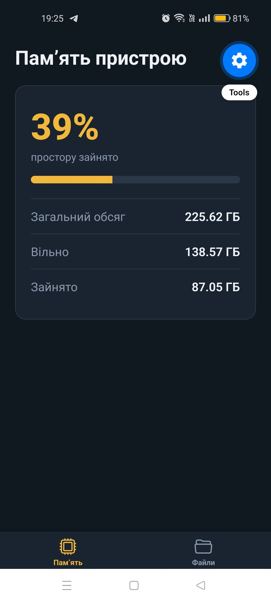
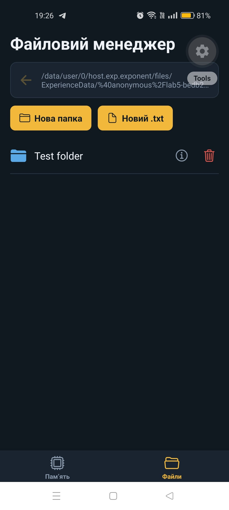
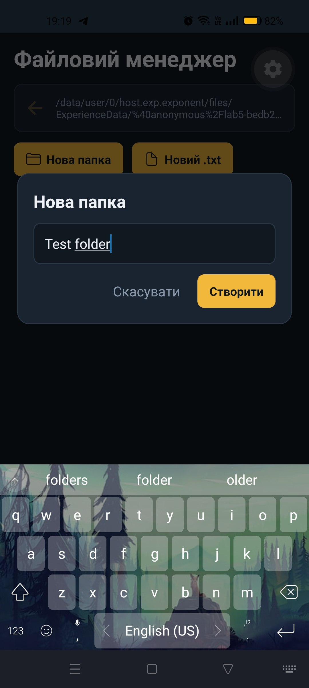
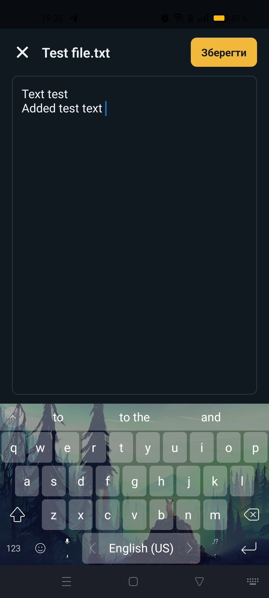
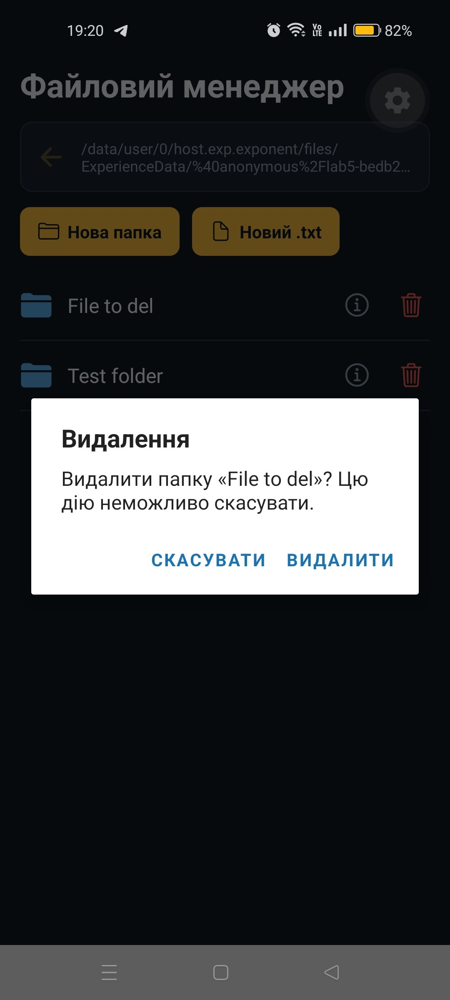
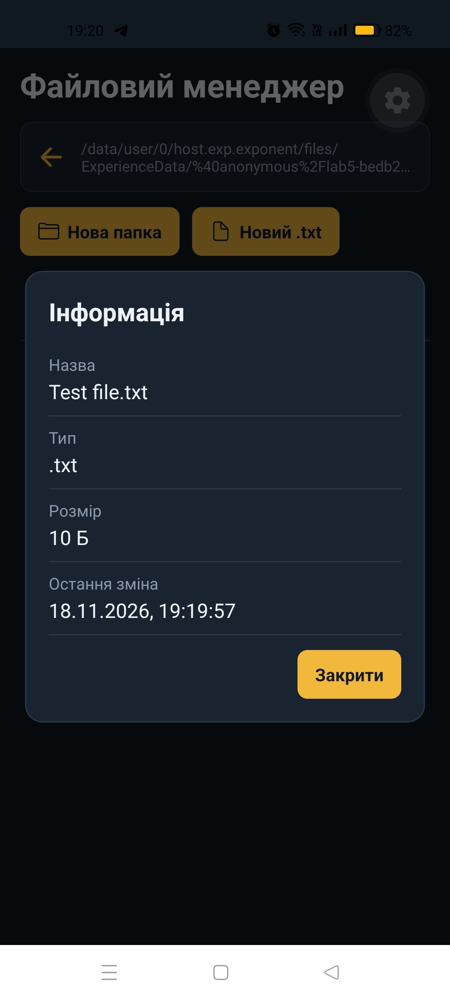

# Лабораторна робота №5: Робота з файловою системою в React Native з використанням expo-file-system
 
## 📝 Опис
 
Був розроблений  застосунок **«Файловий менеджер»** на базі **Expo Router** та бібліотеки **expo-file-system**
 
Застосунок працює з локальною директорією документів додатку `Paths.document` та складається з двох екранів із нижньою панеллю вкладок.
 
### Основні можливості
 
*   **Коренева конфігурація:** `SafeAreaProvider` та `Tabs` у `app/_layout.jsx`; на екранах використано `SafeAreaView` із `react-native-safe-area-context` для захисту від вирізів і системних панелей.
*   **Екран «Пам'ять» (`app/index.jsx`):**
    *   загальний обсяг пам'яті (`Paths.totalDiskSpace`);
    *   вільний простір (`Paths.availableDiskSpace`);
    *   зайнятий простір різниця та індикатор заповнення у відсотках.
*   **Екран «Файли» (`app/files.jsx`):**
    *   **Навігація:** поточний шлях, перехід у вкладені папки, кнопка «назад» неактивна в кореневій директорії; вміст відображається через `FlatList` папки першими, далі файли за алфавітом
    *   **Створення:** нова папка за введеною назвою; новий `.txt` файл з іменем та початковим вмістом (через модальне вікно з `TextInput`). Виконується валідація назви та перевірка на дублікати.
    *   **Читання:** відкриття `.txt` файлів у модальному вікні перегляду.
    *   **Редагування:** режим редагування з кнопкою «Зберегти» (запис через `file.write()`).
    *   **Видалення:** файлів і папок із підтвердженням `Alert.alert()`.
    *   **Деталі:** назва, тип, розмір, дата останньої модифікації (кнопка «i»).
---
 
## 🚀 Інструкція із запуску
 
1. **Клонуйте репозиторій:**
```bash
git clone https://github.com/VanyaBond/MobileLabsRN2026
```
 
2. **Перейдіть до директорії проєкту:**
```bash
cd MobileLabsRN2026/lab5
```
 
3. **Встановіть залежності проєкту:**
```bash
npm install --legacy-peer-deps
```
 
4. **Запустіть сервер розробки:**
```bash
npx expo start --clear
```
 
5. **Запустіть додаток:** Відскануйте QR-код через застосунок **Expo Go** на телефоні або натисніть `a` для емулятора Android.
### Як створювався проєкт
 
```bash
npx create-expo-app@latest lab5
cd lab5
npm run reset-project
npx expo install expo-file-system react-native-safe-area-context
```
 
---
 
## 📱 Скріншоти застосунку
 
| Статистика пам'яті | Навігація по папках | Створення папки / файлу | Перегляд і редагування |
| :---: | :---: | :---: | :---: |
|  |  |  |  |
 
| Підтвердження видалення | Інформація про файл |
| :---: | :---: |
|  |  |
 
---
 
## 📂 Структура проєкту (lab5)
 
```
lab5/
├── app/
│   ├── _layout.jsx     кореневий layout, SafeAreaProvider + Tabs
│   ├── index.jsx       екран статистики пам'яті
│   └── files.jsx       файловий менеджер  навігація, CRUD, інфо
├── src/
│   ├── theme.js        кольорова палітра
│   └── utils.js        форматування розмірів/дат, збір метаданих
├── app.json
├── package.json
└── README.md
```
 
---
 
## 🔍 Контрольні запитання
 
1. **Які основні директорії надає бібліотека expo-file-system і в чому полягає різниця між ними?**
   * **`Paths.document`**  постійне сховище даних застосунку. Файли зберігаються між запусками, не очищаються системою, потрапляють у резервні копії. Використовується для даних користувача 
   * **`Paths.cache`** кеш. Система може видалити їх у будь-який момент при нестачі місця, якраз підходить для завантажених або згенерованих тимчасових файлів
   * **`Paths.bundle`**  каталог із ресурсами, вбудованими в застосунок призначений лише для читання
   * У застарілому API відповідники: `documentDirectory`, `cacheDirectory`, `bundleDirectory`
2. **Які базові методи expo-file-system використовуються для читання, запису, створення директорій та видалення файлів і папок?**
   * **Читання:** `file.text()`, `file.bytes()`; вміст папки  `directory.list()`
   * **Запис:** `file.write(content)`; створення файлу  `file.create()`
   * **Створення директорії:** `directory.create()`.
   * **Видалення:** `file.delete()` та `directory.delete()` + папка видаляється разом із вмістом
   * Також доступні `copy()`, `move()`, `rename()`
   * У застарілому API (`expo-file-system/legacy`): `readAsStringAsync`, `writeAsStringAsync`, `makeDirectoryAsync`, `readDirectoryAsync`, `deleteAsync`.
3. **Як отримати метадані про об'єкт файлової системи та інформацію про загальний і вільний обсяг пам'яті пристрою?**
   * **Метадані:** властивості та метод `info()` екземплярів `File`/`Directory`: `name`, `uri`, `exists`, `size`, `modificationTime`, `type` MIME. У застарілому API це було `getInfoAsync(uri)`.
   * **Обсяг пам'яті:** `Paths.totalDiskSpace` загальний і `Paths.availableDiskSpace` вільний; зайнятий простір обчислюється як різниця. У застарілому API завдяки `getTotalDiskCapacityAsync()` та `getFreeDiskStorageAsync()`.
---
 
## 🏁 Висновок
 
У ході лабораторної роботи №5 розроблено «Файловий менеджер» на Expo Router з використанням бібліотеки expo-file-system. Опановано роботу з об'єктами `File`, `Directory` та `Paths`+ було реалізовано навігацію по локальній файловій системі, створення папок і текстових файлів, читання, редагування та збереження вмісту, видалення з підтвердженням, а також перегляд метаданих і статистики використання пам'яті пристрою. Для коректного відображення на пристроях із вирізами використано safe areas, а для списків `FlatList`